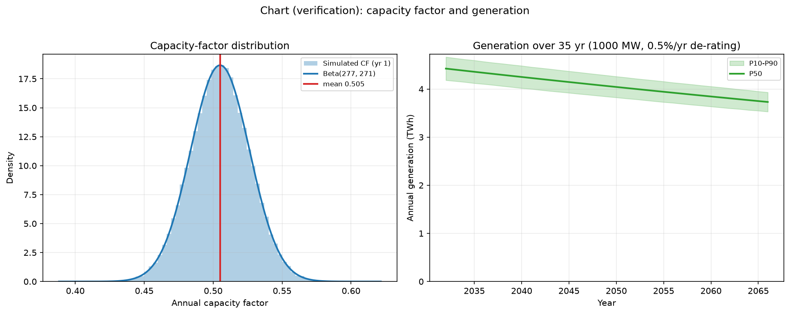
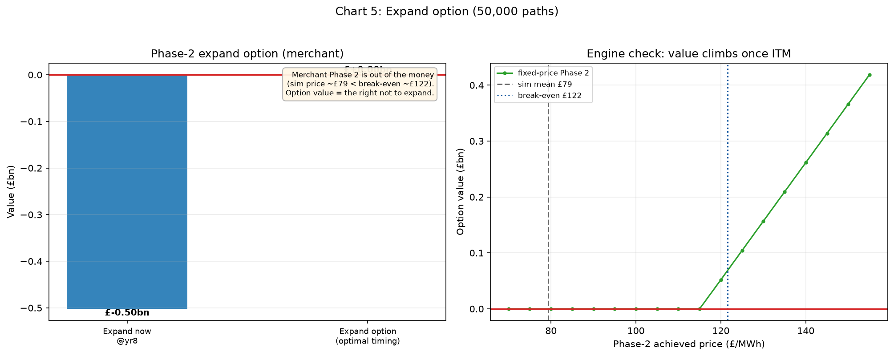
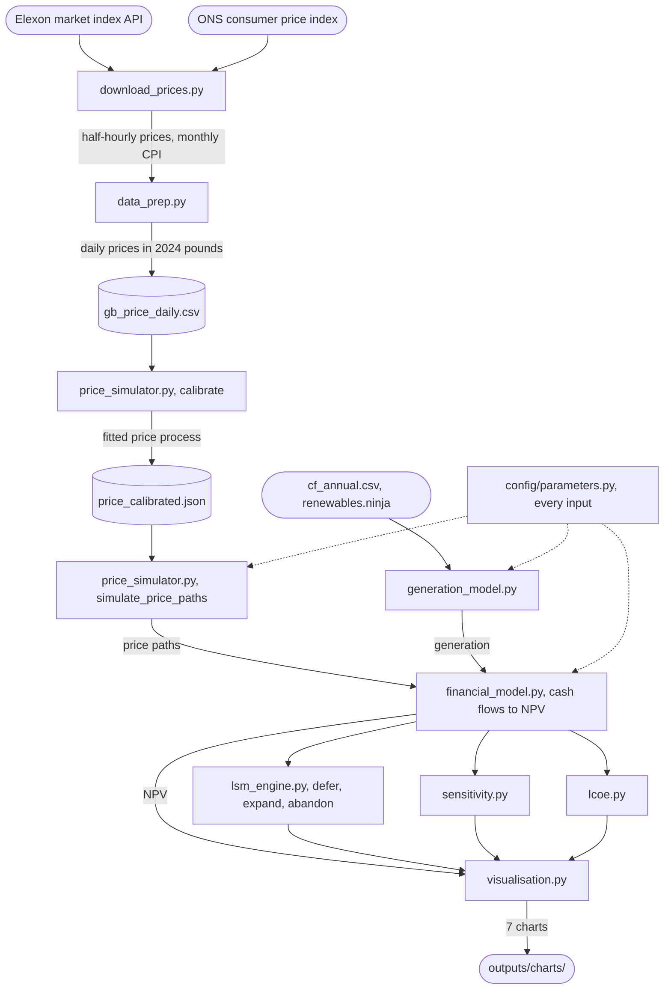

# Offshore Wind Farm, Real Options Valuation

This project works out what a large offshore wind farm is worth, and what the owner's freedom to change course over time adds to that value. The farm is a 1000 MW (1 GW) project off the UK coast.

Two questions drive it. What is the farm worth if the owner commits now. And how much is it worth to be able to wait, expand, or sell later, once electricity prices have moved.

I have written this so that someone with no background in finance or energy markets can follow it. I explain each piece of jargon the first time it appears, but keep the detail intact so it still holds up for a specialist. Every input comes from a public source, and where I could not find one, I say so. The reasons behind the main modelling choices are in [docs/decisions.md](docs/decisions.md).

## What the model finds

On central, sourced assumptions the farm loses money, and none of the owner's flexibility rescues it.

The headline number is the net present value (NPV). This is every future cash flow the project produces, converted into today's money and summed, minus the build cost. Future money is worth less than money now, so converting it back shrinks it, a step called discounting. A positive NPV creates value, a negative NPV destroys it.

The farm's NPV is -£1.19bn. It is negative in every one of the 50,000 futures I simulate, and even the best tenth still loses £1.00bn.

| Question | Answer |
|---|---|
| Farm value if built now | -£1.19bn |
| Value of the right to wait up to 4 years | +£1.19bn, but only as the right not to build |
| Value of the right to add a 500 MW second phase | ~£0 |
| Value of the right to sell mid-life | +£0.18bn |

The flexibility is worth little for one reason. The farm is so far from profitable that no realistic price makes building it worthwhile, even though the simulated price range widens sharply over the decades the farm would run.

## How the model works

### The electricity price

The farm sells at the wholesale price in £/MWh. Nobody knows the future price, so instead of one forecast I simulate 50,000 price paths over the 5 year build and the 35 years of operation, and value the farm on each. This is a Monte Carlo simulation, running the model many times with random draws.

The price history comes from Elexon, which runs the market's settlement. It reports prices in the pounds of each day, so I restate them in 2024 pounds with the consumer price index. I keep the half-hours when the price went negative, which happens on windy days with low demand, because they are part of the true average. Two days in the fit window averaged below zero overall, and the model works in log prices, which need a positive price, so it leaves those two days out.

I build the price from three layers, all in log terms so each is a percentage move.

- A season, a fixed within-year pattern, higher in winter.
- A short-term wobble, fast swings that pull back toward normal. This is a mean-reverting (Ornstein-Uhlenbeck) process, fitted to the last 30 months of prices, January 2024 to June 2026. It reverts fast, with an 18 day half-life, so a spike fades halfway back in under three weeks.
- A long-term drift, where the normal level itself moves on a slow random walk, with no pull back.

The long-term drift is what matters for the options. It lets the price range keep widening with time, the way real long-dated prices behave. A model with only mean reversion settles into a fixed band within weeks, so its range barely grows over decades and every timing option comes out worthless by construction.

I track the spread with P10 and P90, the prices that only 10% of futures fall below and rise above, with P50 the median. The P90 to P10 ratio grows from 1.23 in year 1 to 2.65 in year 40, so a year 1 range of roughly £69 to £84 becomes £46 to £123 by year 40. The average simulated price over the farm's life, £79, matches the average of the 30 months the fit uses. The median sits lower, near £76, because high prices stretch further above it than low prices fall below.

I cannot estimate the drift's size from 30 months of data, so I set it from the literature at 6%/yr and treat it as an assumption to test. I start the fit in 2024 on purpose, to exclude the 2021 to 2023 gas crisis, a one-off that would otherwise dominate a 40 year forecast.


*The shaded band is the P10 to P90 range. It widens with the horizon, driven by the long-term factor. The dark line is the price history in 2024 pounds, and the dashed line marks first power for a farm committed today.*

### How much the farm generates

Output depends on the wind, which varies year to year. The capacity factor is the share of the farm's theoretical maximum output it actually delivers over a year, so 0.50 means half of flat-out running.

I set the average capacity factor to 0.505, the central net figure Arup publishes for a modern UK offshore farm. The year to year variation, a standard deviation of 0.0213, comes from a 20 year record of simulated output for the site. A capacity factor is trapped between 0 and 1, so I draw it from a Beta distribution fitted to that average and spread.

Output falls 0.5%/yr as the turbines age, from 4.42 TWh in the first year of operation to 3.73 TWh in the 35th.



*Left, the capacity factor drawn from the fitted Beta distribution. Right, the yearly output band over the life.*

### Turning prices and output into value

Revenue comes in two stages.

For the first 20 years the farm is paid a fixed price through a Contract for Difference (CfD), the main UK subsidy for new renewables. It pays a set price per MWh, the strike price, whatever the market does, which removes price risk for those years. The strike is £90.91/MWh, from the 2026 auction.

After the CfD the farm sells at the market price of each year it runs, called merchant revenue. A farm committed today first generates after its 5 year build, so its 21st year of operation, the first after the CfD, earns the price simulated for year 26. Wind earns less than the average price here, because every wind farm produces in the same windy hours and that extra supply depresses the price at those times. This is cannibalisation. I apply a capture factor of 0.85, so merchant revenue is 85% of the average price times output.

Against revenue I set four costs. Arup publishes the build and operating costs in 2023 prices, so I restate them in 2024 pounds with the consumer price index, which adds 2.6%. Arup itself works with a different index, the GDP deflator, which rose 3.8% that year. I use the consumer price index to keep costs in the same unit as the CfD and the market prices; the GDP deflator would lower the NPV by about £0.05bn.

- The build cost (CAPEX) is £4,080/kW, or £4.08bn, spread over the 5 year build.
- The operating cost (OPEX) is £142,100/MW/yr, mostly turbine operations and maintenance (O&M) plus the transmission grid charge (TNUoS).
- Tax is 25% of profit. The build cost earns a deduction, the capital allowance, that lowers early tax bills. I use the UK writing-down allowance, 18% of the remaining balance each year.
- Decommissioning, taking the farm down at the end, costs £300,000/MW in the final year.

I discount every future year's cash to today at the weighted average cost of capital (WACC), the annual return investors require, here 6.2% in real terms, and sum it to the NPV.

Averaged over 50,000 futures the NPV is -£1.19bn, and it splits like this.

| Piece | Value today |
|---|---|
| Build cost | -£3.52bn |
| CfD-year profit | +£2.16bn |
| Merchant-year profit | +£0.20bn |
| Decommissioning | -£0.03bn |
| NPV | -£1.19bn |


*Left, the spread of NPV across the 50,000 futures, all negative. Right, the average build up from cost to NPV.*

### Why the farm loses money

The clearest lens is the levelised cost of energy (LCOE), the single flat price per MWh the farm would need every year to break even. When the LCOE sits above the price the farm earns, it loses money.

Arup, for the UK government, publishes an LCOE of £88.5/MWh in 2023 prices, £90.8 in 2024 pounds, from the same cost inputs I use. My model gives more, and src/lcoe.py shows why.

- Pre-tax, my LCOE is £112.5/MWh, £22 above the benchmark. [docs/decisions.md](docs/decisions.md) sets out where that gap comes from.
- After tax, break-even rises to £121.6/MWh. Tax adds the last £9.

The farm earns £90.91 under the CfD. In its merchant years the market price averages about £80, of which wind captures about £68. Both are well below the ~£122 it needs, and that gap is the -£1.19bn.

### The three options

A real option is the right, not the duty, to make a decision later once you have seen how things turn out. Waiting, growing, and quitting all carry value, like a financial option. I value three.

I use Longstaff-Schwartz, the standard method for options that can be exercised on many dates. It steps backwards from the final year, and at each year compares acting now against the estimated value of carrying on, keeping the better one. The estimate is the careful part. The payoff from acting depends on prices that have not happened yet, so reading each future's own later prices would be a look-ahead the owner would not really have. Instead the method estimates both values from the price in the decision year alone, by fitting a curve across all futures, and decides on that. I checked it against a textbook option with a known answer, and it matches.

Defer, the right to wait up to 4 years, is worth +£1.19bn, all of it the right to walk away. Once the owner can decline, a project that loses money on every path is never started, which turns the -£1.19bn into zero. Timing itself, picking a good build year, adds nothing, because no year is good enough. The owner never builds, on 100% of paths.


*The walk-away value is the whole premium over committing now. Pure timing adds nothing.*

Expand, the right to add a 500 MW phase in years 8 to 13 at a 7.5% lower build cost (£3,774/kW) from lessons learned, is worth ~£0. A merchant second phase needs a price it almost never reaches, so it is built on under 1% of paths.



*The option stays near zero until the price a second phase would achieve clears break-even, which merchant prices rarely reach.*

Abandon, the right to sell the running farm mid-life to a buyer with a lower cost of capital, 5.0% against my 6.2%, adds +£0.18bn and lifts the value to -£1.00bn. The same cash flows are worth more to a buyer who discounts them less, so this is a financing gain from the discount-rate gap, not price flexibility. It is taken on 100% of paths at the start, and it rests on two numbers I could not source, the buyer's rate and the 2% sale cost, so I treat it as illustrative.


*The sale add-on grows as the buyer's discount rate falls further below ours, and vanishes when the two match.*

### What moves the answer

I change one input at a time across its sourced range and watch the NPV. Break-even is the value each input would need, on its own, to reach zero.

| Input | NPV, low end | NPV, high end | Break-even |
|---|---|---|---|
| CfD strike price | -£1.43bn | -£0.58bn | £134/MWh |
| Build cost (CAPEX) | -£0.70bn | -£1.53bn | £2,436/kW |
| Grid charge (TNUoS) | -£0.79bn | -£1.60bn | none in range |
| Discount rate (WACC) | -£0.90bn | -£1.63bn | 2.5% |
| Capacity factor | -£1.45bn | -£0.86bn | 0.71 |
| O&M + insurance | -£1.05bn | -£1.35bn | none in range |
| Merchant capture | -£1.26bn | -£1.11bn | none in range |

The CfD strike matters most, though only just ahead of the build cost and the grid charge. It runs from £82.03/MWh, the 2024 auction's price in 2024 pounds, to the £113 cap of the 2026 auction, and it would have to reach £134 to break even. The 2024 price was for a 15 year contract, and a 20 year contract would clear lower, so it is a cautious low end. The build cost would have to fall by two fifths, the discount rate drop from 6.2% to 2.5%, or the capacity factor reach 0.71, well beyond any real farm. No single input reaches zero within its plausible range.


*Each bar swings one input across its range. The CfD strike, build cost and grid charge move the NPV most.*

## Data and sources

All money is in real 2024 pounds. Figures published in another year's prices are restated with the consumer price index. Where a source gives a range I use the central figure and test the low and high in the sensitivity.

| Input | Source | Value |
|---|---|---|
| Wholesale price history | Elexon market index data, January 2018 to June 2026 | Daily GB price in 2024 pounds, short-term fit from January 2024 |
| Inflation | ONS consumer price index, series D7BT | Restates other years' prices in 2024 pounds |
| Build cost (CAPEX) | Arup for the UK government, 2024 | £4,080/kW (£3,976 in 2023 prices), over a 5 year build |
| O&M + insurance | Arup for the UK government, 2024 | £56,500/MW/yr (£55,100 in 2023 prices) |
| Grid charge (TNUoS) | Arup for the UK government, 2024 | £85,600/MW/yr (£83,400 in 2023 prices) |
| Capacity factor | Arup for the UK government for the average, renewables.ninja for the spread | 0.505 average (0.460 to 0.561), 0.0213 standard deviation |
| Operating life, discount rate | Arup for the UK government, 2024 | 35 years, 6.2% real |
| CfD strike and term | UK auction results, January 2026 and September 2024 | £90.91/MWh for 20 years; range £82.03 (the 2024 auction) to the £113 cap |
| Decommissioning | DNV, Crown Estate | £300,000/MW in the final year, price year not stated |
| Corporation tax | UK main rate | 25%, with an 18% writing-down allowance |
| Merchant capture factor | My assumption, for cannibalisation | 0.85 |
| Long-term price volatility | My assumption, from the literature | 6%/yr |
| Second phase cost saving | Arup and IRENA learning rates | 7.5% |
| Buyer discount rate, sale cost | Not sourced, placeholders | 5.0%, 2% |

The price history contains BMRS data © Elexon Limited copyright and database right 2026, used under the [BMRS data licence](https://www.elexon.co.uk/bsc/data/balancing-mechanism-reporting-agent/copyright-licence-bmrs-data/). The consumer price index is from the Office for National Statistics, licensed under the [Open Government Licence v3.0](https://www.nationalarchives.gov.uk/doc/open-government-licence/version/3/).

## What I could not pin down

Five things are weaker than the rest, and I flag them.

- The long-term price volatility, 6%/yr, is a literature assumption, not something the data can pin down. It drives most of the option value, so I report it as a range.
- The buyer's discount rate and sale cost in the abandon option, 5.0% and 2%, have no single source.
- The short-term price fit uses only 30 months. This is deliberate, to exclude the gas crisis, and it only sets the fast wobble. Its two numbers, how fast prices pull back and how hard they jump, are imprecise and shift noticeably with small changes to the data, but they barely move yearly prices. The long-run uncertainty comes from the drift.
- The grid charge is at the central, location-specific figure. A better sited farm pays far less, so part of the loss is a siting choice.
- The year to year spread of output comes from renewables.ninja, a free tool that estimates a turbine's output from past weather. I used one turbine at Dogger Bank in the North Sea, with NASA's MERRA-2 record of the weather from 2000 to 2019. I did not record the turbine model or hub height, so I cannot regenerate that series exactly. The model uses only its spread, a standard deviation of about 4% of average output, which is small next to the price uncertainty.

## Running it

You need Python 3.12, 3.13 or 3.14, and the automatic checks on GitHub use 3.13. If `python3` on your machine is another version, name one of these, for example `make install PYTHON=python3.13`.

```bash
make install      # create ./venv if needed, then install the pinned dependencies
make data         # download the Elexon prices and the ONS price index, then rebuild the daily price file
make test         # run the test suite
make charts       # regenerate every chart at 50,000 paths
make lcoe         # print the levelised cost reconciliation
```

`make data` needs internet access and takes a couple of minutes. It fetches the dates set in `config/parameters.py` and, unless Elexon revises its records, reproduces the committed `data/processed/gb_price_daily.csv`. `make price` then refits the price model to it.

Each part also runs on its own.

```bash
./venv/bin/python -m src.download_prices      # fetch the Elexon prices and the ONS price index
./venv/bin/python -m src.data_prep            # turn them into the daily price series
./venv/bin/python -m src.price_simulator      # recalibrate and show the price range widening
./venv/bin/python -m src.financial_model      # the static NPV
./venv/bin/python -m src.lsm_engine --option=defer
./venv/bin/python -m src.lsm_engine --option=expand
./venv/bin/python -m src.lsm_engine --option=abandon
./venv/bin/python -m src.sensitivity
```

## Project structure

Each file has one job, and the calculation is kept separate from the charts, so every module reads as plain maths. The flow of data through the project is below. Solid arrows carry data, dotted arrows carry the input numbers from the config file.



| File | Job |
|---|---|
| config/parameters.py | Every input number, in one place |
| src/download_prices.py | Download the raw half-hourly prices from Elexon and the consumer price index from ONS |
| src/data_prep.py | Turn the raw price download into a daily series in 2024 pounds |
| src/price_simulator.py | Calibrate and simulate the electricity price |
| src/generation_model.py | Turn the capacity factor into yearly output |
| src/financial_model.py | Turn prices and output into cash flows and the NPV |
| src/lcoe.py | Reconcile the model to the published cost benchmark |
| src/lsm_engine.py | Value the defer, expand and abandon options |
| src/sensitivity.py | Show which input moves the NPV most |
| src/visualisation.py | Draw every chart |
| tests/ | Checks on the maths, including the option engine against a known answer, and on the data downloads and daily prices |
```
