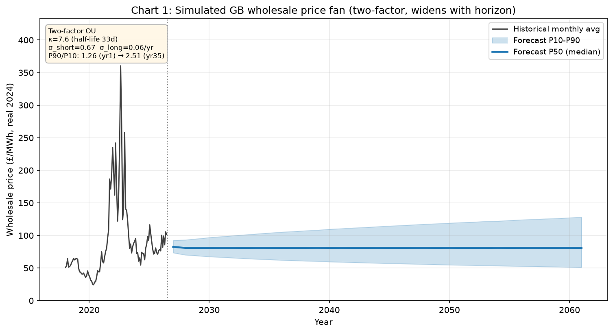
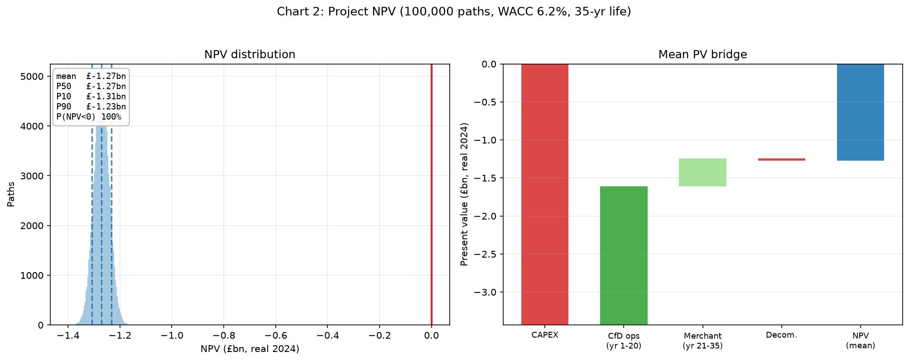

# Offshore Wind Farm: Real Options Valuation

A Monte-Carlo DCF of a 1 GW UK offshore wind farm, extended with a Longstaff-Schwartz
real-options layer that values the flexibility to defer, expand, or abandon the project as the
future unfolds. It is a personal learning project. The modelling is transparent and
every input is sourced, or flagged where it is not.

## Headline finding

On central, publicly-sourced assumptions the project is robustly uneconomic, and managerial
flexibility does not rescue it.

The static NPV is -£1.27bn, and it is negative on 100% of 100,000 simulated price paths. Even the
best-decile P90 outcome is -£1.23bn.

Deferring the build is worth about £0 of price-timing value. Almost all of the apparent defer
premium is just the right not to build a value-destroying project, which is worth +£1.27bn, that
is zero NPV, by definition.

Expanding with a 500 MW Phase 2 is worth about £0. Simulated merchant prices, mean £84.6/MWh, sit
far below the roughly £120/MWh the expansion needs to break even, so it is never optimal to
exercise.

Abandoning, a mid-life sale to a lower-WACC buyer, adds +£0.24bn and lifts the headline to
-£1.03bn. This is a financing arbitrage, a WACC-gap transfer, not price flexibility. It is
exercised on 100% of paths at the first opportunity, with zero timing premium, and it rests on
two unsourced placeholder inputs.

The economic reason the options are muted is itself the interesting result. A 20-year
fixed-strike CfD plus a fast mean-reverting single-factor price model means most of project value
is deterministic. A CfD substitutes for managerial flexibility. See [Caveats](#caveats).

## Results

100,000 paths, WACC 6.2%, 35-yr life, CfD £90.91/MWh for 20 yr then merchant. All figures real
2024 £.

| Quantity | Value | Reading |
|---|---:|---|
| Static NPV, commit today | -£1.27bn | P10 -£1.31bn, P50 -£1.27bn, P90 -£1.23bn, P(NPV<0) 100% |
| Defer option, delay up to 4 yr | +£0.00bn | All premium is the right not to build, price-timing value about £0 |
| Expand option, +500 MW Phase 2 | +£0.00bn | Deep out-of-the-money, never exercised |
| Abandon option, mid-life divest | +£0.24bn | Lifts the headline to -£1.03bn, a WACC-gap arbitrage, not flexibility |

The mean PV bridge behind the static number is CAPEX -£3.43bn, CfD operating PV +£1.82bn,
merchant-tail PV +£0.37bn, and decommissioning -£0.03bn. The gap to break-even is driven by tax
drag and two conservative inputs, TNUoS and depreciation, covered below, not by a single
modelling error. No single sourced lever reaches NPV = 0 within its sourced range.

### Charts

| | |
|---|---|
|  |  |
| Simulated electricity-price fan, single-factor OU | NPV distribution and mean PV bridge |
|  |  |
| Static-NPV tornado and break-evens | Defer option, walk-away versus price-timing |
|  |  |
| Expand option versus the price Phase 2 achieves | Abandon, add-on and its WACC-gap sensitivity |

## Realism refinements

Two refinements stress-test the headline. Both are opt-in, leaving the validated base case
bit-identical, and each is reported as a delta rather than baked into the headline.

UK capital allowances replace 35-yr straight-line with front-loaded depreciation. Bringing the
tax shield forward raises NPV by +£257m on the 18% writing-down allowance, up to +£407m under
full expensing. That is material, but the project stays underwater, at -£1.01bn to -£0.86bn.

CF and price correlation captures cannibalisation at rho = -0.15, injected through a Gaussian
copula that preserves the capacity-factor marginal exactly. The effect on NPV is under £1m. The
correlation bites only in the heavily-discounted merchant tail, while the CfD years are
price-independent.

Both run through `financial_model.run()`, `depreciation_method="wda_18"` or `"full_expensing"`
for the allowances and `cf_price_corr=-0.15` for the correlation. The base case is straight-line
and independent.

## How it works

| Step | Method |
|---|---|
| Prices | Single-factor Ornstein-Uhlenbeck on deseasonalised log-price. Monthly calibration by exact-MLE AR(1) on the post-crisis window 2024-01-01 to 2026-06-30, with antithetic variates. |
| Generation | Annual capacity factor as a Beta drawn through a Gaussian copula, so antithetic pairing and the optional CF and price correlation both work, with linear age degradation. |
| Cash flows | Hybrid revenue, a 20-yr fixed CfD strike then a 15-yr merchant tail, mid-year-discounted DCF, CAPEX spread over construction, a depreciation tax shield, and terminal decommissioning. |
| Options | Look-ahead-free Longstaff-Schwartz, Gamba 2003. Regress both the commit payoff and the continuation value on the observed price state, decide on the fitted conditional expectations, and bank the realised outcome. |

The LSM is validated against closed-form identities. Defer with zero deferral reproduces the
static NPV to the penny, the abandon spine reconstructs the static NPV, and the no-arbitrage
divestment add-on is exactly zero when the buyer shares our WACC. These run in the test suite.

## Data and assumptions

Every external input, its source, and where it enters the code. Money is real 2023/24 GBP. Where
a source gives a range, the central figure is used by default. Two inputs for the abandon option
are unsourced placeholders, flagged below and reported only as a sensitivity.

| Input | Source | What it provides | Where used in code | Value and notes |
|---|---|---|---|---|
| Wholesale price history | Elexon | Daily GB wholesale price, 2018 to 2026 | `data_prep.py`, `price_simulator.py` | Calibrated on the post-crisis window from 2024-01-01, monthly OU fit |
| CAPEX | Arup for DESNZ Offshore Wind LCOE 2024, Table 3 | Total capital cost | `parameters.py`, `financial_model.py` | central £3,976/kW, range £3,321 to £4,439, spread over a 5-yr build |
| OPEX excluding grid | Arup for DESNZ 2024, Table 3 | O&M and insurance | `parameters.py`, `financial_model.py` | central £55.1k/MW/yr, being O&M £46.5k and insurance £8.6k |
| TNUoS grid charge | Arup for DESNZ 2024, Table 3 | Location-specific transmission charge, part of OPEX | `parameters.py`, `sensitivity.py` | central £83.4k/MW/yr, range £35.3k to £132.9k, the dominant NPV lever |
| Net load factor | Arup for DESNZ 2024, Table 3 | Capacity-factor scenarios | `generation_model.py` | central 0.505, range 0.46 to 0.561 |
| Capacity-factor moments | Net mean DESNZ and Potisomporn & Vogel 2022. Interannual SD from renewables.ninja MERRA-2 20-yr, DNV cross-check | Mean and interannual variability for the Beta fit | `generation_model.py` | net mean 0.50, interannual SD 0.0213 or about 3.6% of the mean from the ninja series. Ninja gross mean 0.589 not used, single-cell before wake and availability |
| Operating life | Arup for DESNZ 2024, Table 3 | Asset life | `parameters.py` | 35 years |
| Hurdle rate, WACC | Arup for DESNZ 2024, from BloombergNEF H2-2023 | Pre-tax real discount rate | `parameters.py`, `financial_model.py` | 6.2%, sensitivity 5.0% to 9.0% |
| CfD strike and term | DESNZ CfD AR7 Results, Jan 2026 | Fixed-bottom offshore strike and contract length | `parameters.py`, `financial_model.py` | strike £90.91/MWh on a 2024 basis, 20-yr term, admin cap £113/MWh |
| Decommissioning | DNV, Crown Estate | Terminal liability in the final year | `parameters.py`, `financial_model.py` | £300k/MW central, against DNV €200 to 600k/MW and Crown Estate about £426k/MW gross |
| Corporation tax | UK main rate | Tax on operating profit | `parameters.py`, `financial_model.py` | 25%, simplified, no marginal relief |
| Capital allowances | UK writing-down allowance and full expensing | Front-loaded tax shield, opt-in refinement | `financial_model.py` | 18% reducing-balance WDA, or full expensing. Base case is straight-line |
| Phase 2 cost learning | Arup and IRENA learning rates | £/kW reduction for the expand option | `lsm_engine.py` | 7.5%, within a 5 to 10% range |
| Output degradation | Industry rule of thumb | Annual output decline with age | `generation_model.py` | 0.5%/yr, not a hard citation |
| Buyer WACC, PLACEHOLDER | Unsourced | Lower cost of capital of the divestment buyer | `lsm_engine.py` abandon | 5.0%, not pinned to a source, drives the abandon add-on, reported only as a sensitivity |
| Transaction cost, PLACEHOLDER | Unsourced | Divestment friction, fraction of enterprise value | `lsm_engine.py` abandon | 2.0%, not pinned to a source, reported only as a sensitivity |

## Caveats

1. Muted options are model-driven, and that is the finding. A single-factor OU fan flattens after
   roughly one half-life, about 6 weeks here, and the CfD fixes revenue for 20 years, so the live
   price uncertainty the defer and expand options key off survives only in the distant merchant
   tail. The honest fix is a two-factor price model, a short-term deviation plus a stochastic
   equilibrium, described in `docs/future_work.md`.
2. The abandon add-on is a financing arbitrage, not flexibility. It is a deterministic WACC-gap
   transfer to a lower-WACC buyer, exercised on 100% of paths at COD with zero timing premium, and
   it depends on two unsourced placeholder inputs, buyer WACC 5.0% and transaction cost 2%.
3. Conservative inputs make the static case look worse than a tuned bid would. TNUoS sits at the
   Arup-central, location-specific charge, about +£20/MWh on LCOE, and straight-line depreciation
   understates the real tax shield, since capital allowances add £257m to £407m as above. Neither
   flips the sign.
4. Capacity factor is drawn independently of price by default. The CF and price correlation is
   opt-in and immaterial, under £1m.
5. Monthly price calibration uses only 29 transitions, a small sample. It is chosen deliberately,
   because daily and weekly fits over-amplify mean reversion and collapse the year-to-year band.
6. Capacity-factor moments are split by provenance. The net mean stays the sourced figure, 0.50,
   from DESNZ and Potisomporn & Vogel, because a farm load factor has to be net of wake and
   availability losses. The interannual SD, 0.0213, now comes from a 20 year renewables.ninja
   MERRA-2 pull for the Dogger Bank cell. That is 3.6% of the ninja series mean, and about 4.3% of
   the 0.50 net mean the model applies it to, tighter than the old conservative 0.045 and inside
   the DNV 4 to 5.5% range. The ninja raw mean, 0.589, is single-cell and gross of those losses, so
   it is deliberately not used as the load factor. Set CF_NINJA_MODE in config to both to also adopt
   the ninja mean, or off to revert to the conservative 0.045.

## Reproduce

```bash
make install        # pinned deps into ./venv
make test           # deterministic pytest suite, validates the spine and LSM identities
make charts         # regenerate all charts at 50k paths, override with N=...
make charts-final   # production quality at 100k paths
```

Each module also runs on its own, printing a verification report and saving its chart.

```bash
make price | generation | npv | sensitivity | defer | expand | abandon
# or run a single module directly
./venv/bin/python -m src.lsm_engine --option=abandon --n=100000
```

## Project structure

```
offshore-wind-real-options/
├── config/            # All model parameters and the calibrated price-process inputs
├── data/
│   ├── raw/           # Source downloads, gitignored, large
│   └── processed/     # Cleaned, calibration-ready data
├── src/               # The model, see below
├── tests/             # Deterministic validation suite
├── docs/              # Future-work note
└── outputs/charts/    # Saved charts
```

| Module | What it does |
|---|---|
| `data_prep.py` | Builds the calibration-ready daily price series from the raw Elexon download |
| `price_simulator.py` | Calibrates and simulates electricity-price paths, chart 1 |
| `generation_model.py` | Models annual output via a Beta capacity factor, generation chart |
| `financial_model.py` | Turns prices and output into cash flows and NPV, chart 2 |
| `sensitivity.py` | Static-NPV tornado and lever break-evens, chart 3 |
| `lsm_engine.py` | Values the defer, expand and abandon options, charts 4 to 6 |
| `visualisation.py` | One command to regenerate every chart |

All money is in real 2023/24 GBP. Inputs are sourced from UK government offshore-wind cost
reports, DESNZ and Arup, AR7 CfD auction results, and published capacity-factor data. See
`config/parameters.py`.
