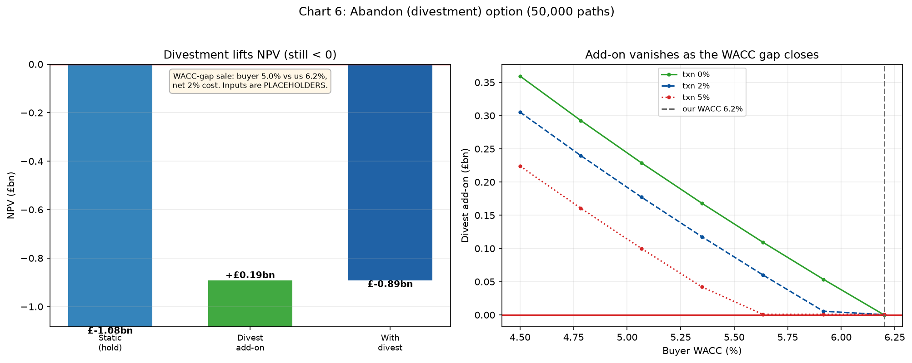

# Offshore Wind Farm: Real-Options Valuation

A Monte-Carlo DCF of a 1 GW UK offshore wind farm, with a Longstaff-Schwartz layer that values the
flexibility to **defer**, **expand**, or **abandon** the project as prices unfold. Every input is
sourced, or flagged where it is not, and every module is written to be read and explained.

## Headline finding

On central, publicly-sourced assumptions the project is **robustly uneconomic, and managerial
flexibility does not rescue it**.

- **Static NPV −£1.08bn**, negative on 100% of 50,000 simulated price paths (even the P90 outcome
  is −£0.90bn). The project's after-tax break-even price is ~£120/MWh, but the CfD strike is
  £90.91 and simulated wholesale prices average ~£84.
- **Deferring** the build up to 4 years adds ~£0 of price-timing value. Its whole premium
  (+£1.08bn) is simply the right *not* to build a value-destroying project — i.e. zero NPV.
- **Expanding** with a merchant 500 MW Phase 2 is worth ~£0: it is deep out-of-the-money, exercised
  on only ~2% of paths.
- **Abandoning** (a mid-life sale to a lower-WACC buyer) adds +£0.19bn, lifting the headline to
  −£0.89bn. This is a financing arbitrage — a WACC-gap transfer — not price flexibility, and it
  rests on two unsourced placeholder inputs.

The important point: unlike a naive model, the muted timing options here are **not** an artifact of
the price model. The price fan genuinely widens with the horizon (see below), so decades-out
uncertainty is real — the options are muted because the economics are simply too far underwater for
any plausible price to rescue them.

## Results

50,000 paths, WACC 6.2%, 35-yr life, CfD £90.91/MWh for 20 yr then merchant. Real 2024 £.

| Quantity | Value | Reading |
|---|---:|---|
| Static NPV, commit today | −£1.08bn | P10 −£1.24 · P50 −£1.10 · P90 −£0.90 · P(NPV<0) 100% |
| Defer, delay up to 4 yr | +£0.00bn | All premium is the right not to build; price-timing ≈ £0 |
| Expand, +500 MW merchant Phase 2 | +£0.00bn | Deep out-of-the-money, exercised on ~2% of paths |
| Abandon, mid-life divest | +£0.19bn | Lifts headline to −£0.89bn; a WACC-gap arbitrage, not flexibility |

Mean PV bridge behind the static number: CAPEX −£3.43bn, CfD operating PV +£2.14bn, merchant-tail
PV +£0.23bn, decommissioning −£0.03bn. Why the gap to break-even? `python -m src.lcoe` shows it:
the model's pre-tax LCOE is £110.7/MWh (+£22 vs the £88.5 Arup benchmark, from the 5-year build lag
and mid-year discounting), and tax lifts the after-tax break-even to £119.7/MWh — both far above
the £90.91 CfD.

### Charts

| | |
|---|---|
|  |  |
| Two-factor price fan (widens with horizon) | NPV distribution and mean PV bridge |
|  |  |
| Static-NPV tornado and break-evens | Defer: walk-away vs price-timing |
|  |  |
| Expand value vs the price Phase 2 achieves | Abandon add-on and its WACC-gap sensitivity |

## How it works

The pipeline is a chain of small, single-purpose modules. Computation is kept separate from
plotting: every chart lives in `visualisation.py`, so each model module is pure, readable maths.

| Step | Module | Method |
|---|---|---|
| Prices | `price_simulator.py` | **Two-factor model** in log space: season + a fast mean-reverting short-term factor (fitted to recent monthly prices) + a slow **random-walk long-term level**. The random walk makes the price fan keep widening with the horizon, so long-dated uncertainty is real. |
| Generation | `generation_model.py` | Annual capacity factor drawn from a Beta fitted to a sourced net mean and a measured year-to-year spread; compound age de-rating. |
| Cash flows | `financial_model.py` | Hybrid revenue (20-yr fixed CfD, then merchant price haircut by a **capture factor**), mid-year-discounted DCF, CAPEX over the build, an 18% writing-down capital allowance (the realistic UK tax shield), terminal decommissioning. |
| LCOE check | `lcoe.py` | Reconciles the model's economics to the published £88.5/MWh LCOE benchmark, so the negative NPV is transparent. |
| Options | `lsm_engine.py` | Longstaff-Schwartz Monte Carlo. At each yearly node, compare "act now" against the regression-estimated value of waiting. Validated against a binomial-tree American put in the test suite. |
| Sensitivity | `sensitivity.py` | One-at-a-time tornado on the static NPV, plus each lever's break-even. |

## Key modelling choices

- **Two-factor prices.** A one-factor mean-reverting model snaps back to its average within weeks,
  leaving the 35-year fan almost flat and *forcing* timing options to ~£0. The long-term
  random-walk factor fixes this: P90/P10 grows from ~1.3 (year 1) to ~2.6 (year 35). Its volatility
  cannot be estimated from ~2.5 years of data, so it is a forward-looking assumption
  (`PRICE_LT_VOL`, 6%/yr) reported as a sensitivity.
- **Merchant capture factor (0.85).** Wind sells below the time-average price because it generates
  when other wind farms do, depressing the price ("cannibalisation"). Applies to merchant years
  only; CfD years are unaffected.
- **Capital allowances.** The base case uses the standard UK 18% writing-down allowance (front-loaded
  tax shield), not conservative straight-line.

## Data and assumptions

Money is real 2023/24 GBP; central figures are default, ranges feed the sensitivity. Two abandon
inputs are unsourced placeholders, reported only as a sensitivity.

| Input | Source | Value / notes |
|---|---|---|
| Wholesale price history | Elexon | Daily GB price; short-term factor fitted from 2024-01-01 (post gas-crisis) |
| CAPEX | Arup for DESNZ LCOE 2024, Table 3 | £3,976/kW central (£3,321–4,439), over a 5-yr build |
| OPEX: O&M + insurance | Arup for DESNZ 2024 | £55.1k/MW/yr central |
| OPEX: TNUoS grid charge | Arup for DESNZ 2024 | £83.4k/MW/yr central (£35.3–132.9k); the dominant cost lever |
| Capacity factor | DESNZ net mean; renewables.ninja for the spread | net mean 0.50, year-to-year SD 0.0213 |
| Operating life / WACC | Arup for DESNZ 2024 | 35 yr; 6.2% pre-tax real (5.0–9.0%) |
| CfD strike & term | DESNZ AR7 Results, Jan 2026 | £90.91/MWh, 20 yr, admin cap £113 |
| Decommissioning | DNV, Crown Estate | £300k/MW in the final year |
| Corporation tax | UK main rate | 25%, with an 18% writing-down capital allowance |
| Merchant capture factor | Assumption (cannibalisation) | 0.85 (0.70–1.00) |
| Long-term price volatility | Assumption (Schwartz-Smith literature) | 6%/yr (4–10%); reported as a sensitivity |
| Phase-2 cost learning | Arup / IRENA | 7.5% cheaper £/kW |
| Buyer WACC / transaction cost | **Unsourced placeholders** | 5.0% / 2%; drive the abandon add-on only |

## Caveats

1. **The abandon add-on is a financing arbitrage, not flexibility** — a deterministic WACC-gap
   transfer, exercised at commissioning on 100% of paths, resting on two unsourced placeholders.
2. **The long-term price volatility is an assumption, not an estimate** (too little history), so it
   is always shown as a sensitivity. It is the main driver of any tail option value.
3. **The short-term factor is fitted to ~30 months of data.** That window is deliberate (it excludes
   the 2021–23 gas crisis), and it only sets the fast-reverting behaviour; long-horizon uncertainty
   comes from the long-term factor, not this fit.
4. **Conservative economics.** TNUoS is at the location-specific central charge (~+£20/MWh on LCOE);
   a better-sited project would be less negative. No single sourced lever reaches NPV = 0 in range.

## Reproduce

```bash
make install      # pinned deps into ./venv
make test         # deterministic pytest suite (DCF identities, price fan, LSM vs binomial)
make charts       # regenerate all charts (N=50000; override with N=...)
make lcoe         # print the LCOE reconciliation
```

Each module runs on its own too:

```bash
./venv/bin/python -m src.price_simulator      # recalibrate + show the fan widening
./venv/bin/python -m src.financial_model      # static NPV
./venv/bin/python -m src.lsm_engine --option=defer|expand|abandon
./venv/bin/python -m src.sensitivity
```

## Project structure

```
config/       parameters.py (all inputs) + price_calibrated.json (fitted price process)
data/         raw/ Elexon download (gitignored) · processed/ cleaned, calibration-ready CSVs
src/          the model (one job per file, below)
tests/        deterministic validation suite
outputs/charts/  saved charts
```

| Module | Job |
|---|---|
| `data_prep.py` | Raw Elexon feed → clean daily price series |
| `price_simulator.py` | Calibrate + simulate two-factor price paths |
| `generation_model.py` | Beta capacity factor → annual generation |
| `financial_model.py` | Prices + generation → cash flows → NPV |
| `lcoe.py` | Reconcile the model to the published LCOE benchmark |
| `lsm_engine.py` | Value the defer / expand / abandon options |
| `sensitivity.py` | Static-NPV tornado and break-evens |
| `visualisation.py` | All charts (the only module that plots) |
